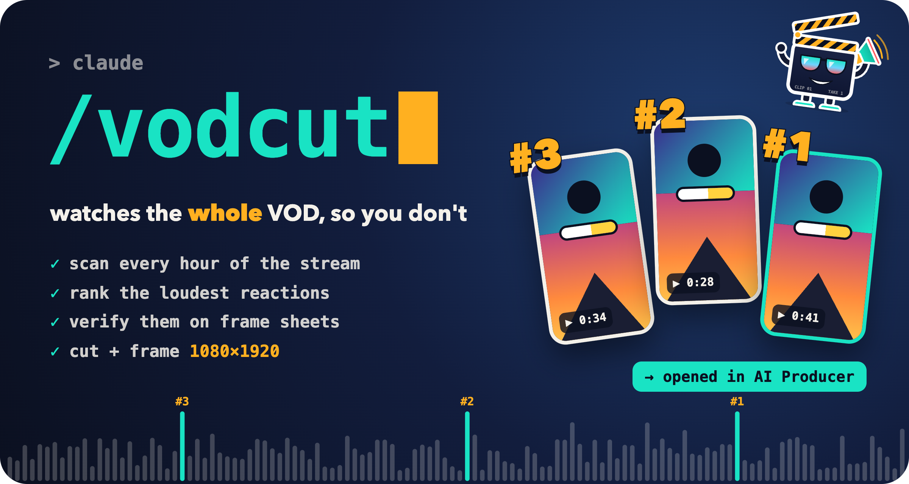

<div align="center">



# /vodcut

**Your agent watches the whole stream. You post the 40 seconds that matter.**

My agent watched **23.76 hours** of IShowSpeed's GTA 6 stream and ranked **2,852 thirty-second windows** into
the top **20 moments** in **1:03:27**, for **$0** in API calls.

</div>

- Hand it any VOD (YouTube, Twitch, Kick or a local file), get back the moments worth posting
- Transcribes every hour on your machine with whisper.cpp and ranks 30-second windows by loudness + reaction cues
- Finds the moments fans already clipped by phrase, and checks every winner on a frame sheet before cutting
- Cuts and frames each one 1080x1920: facecam on top, gameplay below, 30 fps
- Opens each clip in AI Producer, where captions and export happen: you get an editable project link
- Fully open source (MIT). One skill, works as a plugin or as a plain `~/.claude/skills` folder

[Install](#install) · [Use](#use) · [How it works](#how-it-works) · [The numbers](#the-numbers) · [FAQ](#faq)

---

## Install

**1. AI Producer's official plugin** (the clips open there):

```bash
claude plugin marketplace add https://github.com/opus-pro/ai-producer-plugin.git#main
claude plugin install aip@ai-producer-plugins --scope user
```

Start a new session and sign in with `/mcp` -> `plugin:aip:ai-producer` (your OpusClip account, in the browser).
AI Producer in coding agents is in beta for a limited set of accounts.

**2a. /vodcut as a plugin**

```text
/plugin marketplace add steven-van-opus/vodcut
/plugin install vodcut@vodcut
```

Run it as `/vodcut:vodcut`. The plugin declares `aip@ai-producer-plugins` as a dependency: with step 1 done, Claude
Code keeps it enabled; without it, /vodcut installs but does not load.

**2b. /vodcut as a plain skill**

```bash
git clone https://github.com/steven-van-opus/vodcut.git
mkdir -p ~/.claude/skills && cp -R vodcut/skills/vodcut ~/.claude/skills/vodcut
```

Run it as `/vodcut`. The scripts travel inside the skill folder.

gtavi-aiproducer already includes the /vodcut scan; install one or the other. Both ship a skill named `vodcut`, so
with both installed a bare `/vodcut` goes to whichever loaded first.

**3. Local tools**

```bash
brew install ffmpeg yt-dlp whisper-cpp
mkdir -p ~/.cache/whisper && curl -L -o ~/.cache/whisper/ggml-large-v3-turbo-q5_0.bin \
  https://huggingface.co/ggerganov/whisper.cpp/resolve/main/ggml-large-v3-turbo-q5_0.bin
```

Python 3.9+ (standard library only).

## Use

```text
/vodcut https://www.youtube.com/watch?v=<VOD_ID> 5
```

1. Scans the whole VOD in the background (resumable), then ranks the moments.
2. Adds the moments fans already clipped, if you name them ("is that hulk").
3. Shows you the top moments as frame sheets and picks the winners with you.
4. Measures the facecam once, then cuts and frames each winner 1080x1920.
5. Opens every clip in AI Producer and gives you each project link.
6. Captions, sound and the MP4 export happen in AI Producer, on request.

## How it works

```text
VOD ──ytfrag.py / yt-dlp──> audio.m4a ──scan_vod.py──> transcript + loudness ──rank_windows.py──> moments
     ──vodcut.py find──> + known moments ──vodcut.py verify──> frame sheets (Claude looks at every one)
     ──vodcut.py cut──> 1080x1920 clips (frame.py) ──vodcut.py prep──> sign_upload args
     ──AI Producer──> project + transcript + captions + export + editable link
```

- **YouTube VODs, both ways YouTube serves them.** Post-live VODs still served as 2-second fragments, where
  `yt-dlp --download-sections` fails, go through `ytfrag.py`: parallel, rotated signed URLs, resumes and retries.
  Processed VODs (YouTube processes them later; the launch-day VODs took about a day) go through yt-dlp.
  `vodcut.py` asks yt-dlp which one it is before every download, and `ytfrag.py` refuses a processed VOD rather
  than pull the whole file once per fragment.
- **Score** = loudness z-score of a window's 5 loudest seconds + 0.35 x reaction cues + 0.01 x words. Whisper's
  repetition loops (it repeats a line over music) are cleaned first, so a hallucination cannot win.
- **Review flags** on every moment: `profanity` (bleep it), `sexual`, `spoiler`, `loop`.
- **AI Producer** is where the edit lives, and it is not asked to do what it does not do: its sources are capped at
  about 30 minutes and it keeps the source orientation, so /vodcut finds the moment and frames it vertical first.

| Script (`skills/vodcut/scripts/`) | What it does |
|---|---|
| `vodcut.py` | The pipeline: `scan`, `find`, `verify`, `cut`, `prep`, `report` |
| `ytfrag.py` | Exact windows or whole tracks of YouTube post-live VODs still served as 2-second fragments |
| `scan_vod.py` | Loudness + chunked whisper.cpp transcription, resumable |
| `scan_frags.py` | Transcribes while a fragment-served download is still running |
| `rank_windows.py` | Ranked 30 s windows, loop cleaning, review flags, distinct moments |
| `framesheet.py` | 12 frames of a moment in one image |
| `frame.py` | Facecam grid, 9:16 still, 1080x1920 compose (stack, inset, full) |
| `bleep.py` | Word timings and baked-in bleeps before upload |
| `aip_prep.py` | AI Producer limit check, `sign_upload` arguments, provenance + credit |

Every script answers `--help`. Tests: `python3 -I -m unittest discover -s tests -v`.

## The numbers

The launch line comes from one fresh, uninterrupted run on 2026-11-20, saved as
[`docs/launch-run.json`](docs/launch-run.json) (its `vodcut.py report --json`, without the transcript lines):

```bash
python3 -I skills/vodcut/scripts/vodcut.py scan qSyo5d-dVzA vodcut/speed-1118
```

| | |
|---|---|
| Stream | IShowSpeed's first GTA 6 stream on YouTube (`qSyo5d-dVzA`) |
| Hours scanned | 23.76 |
| 30-second windows ranked | 2,852 |
| Moments kept | 20 (the `--moments` default), best first |
| Wall time | 1:03:27 |
| API cost | $0 (ffmpeg, yt-dlp and whisper.cpp run locally) |

The wall time runs from the audio download to the ranked moments, on one M1 Ultra Mac that had other jobs
running. `report` prints a wall time only for a folder whose first scan fetched the audio itself and ran start to
finish; your machine and connection set yours.

AI Producer's own steps are priced live by AI Producer (`get_pricing`) before anything runs.

## FAQ

**Does AI Producer find the moments?** No, /vodcut does, on your machine. AI Producer edits the clips once they exist.

**Does it make 16:9 streams vertical?** Yes, /vodcut does that with ffmpeg before the upload; AI Producer keeps a
source's orientation.

**Twitch and Kick?** Yes, through yt-dlp: the audio for the scan, a 360p preview per moment, and full quality only for
the windows you pick.

**What leaves my machine?** Only the clips you choose to open in AI Producer. The scan, the transcript and the
previews stay local.

**Credits?** Every clip gets a provenance file with the source link, times and a credit line
(`🎥 @streamer (Platform)`). Credit is courtesy, not a license: keep clips short and transformed.

## Disclaimer

Not affiliated with or endorsed by Rockstar Games, Take-Two Interactive, IShowSpeed or any streamer named here.
Stream footage belongs to its owners: credit them, follow each game's video policy and every campaign's brief, and
take a clip down when asked. AI Producer and OpusClip are products of OpusClip, used through the official `aip`
plugin. MIT licensed, see [LICENSE](LICENSE).
